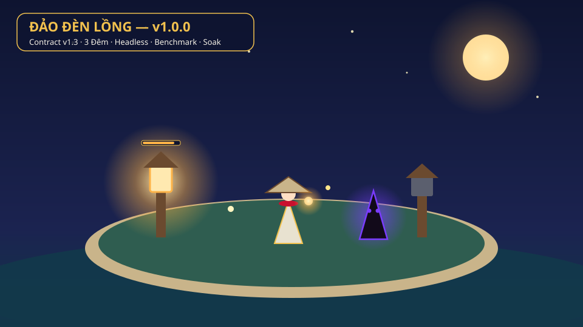

# 🏮 Đảo Đèn Lồng — v1.0.0 (Contract v1.3)

> **Video demo (< 5 phút):** [Xem video demo trực tiếp (`docs/demo/demo.mp4`)](docs/demo/demo.mp4) *(cũng đính kèm trong GitHub Release `v1.0.0`)*



Game 3D góc nhìn thứ ba qua **3 Đêm**: **Đêm 1 — Đảo Bến (240 s)**, **Đêm 2 — Đảo Cau (270 s)** và **Đêm 3 — Đảo Chuông (300 s)**. Điều khiển **Mây** (đội nón lá treo đèn lồng nhỏ) gom đom đóm để thắp sáng, châm dầu và bảo vệ các Đèn Lồng Lớn khỏi Bóng Mực hút dầu và Gió Lạc — **giữ đảo sáng tới bình minh**!

---

## Yêu cầu hệ thống
- **Python 3.10+** (0 thư viện ngoài — chỉ dùng Python Standard Library).
- Trình duyệt hiện đại hỗ trợ WebGL (Chrome / Chromium / Edge / Firefox / Safari) cho bản 3D và chế độ Benchmark.
- Hệ điều hành: **macOS, Linux hoặc Windows** (kèm `Dockerfile` tùy chọn).

---

## Cài đặt & Chạy game (tối đa 3 lệnh)

```bash
# 1. Kiểm tra biên dịch
python3 -m compileall -q src

# 2. Khởi chạy game 3D (tự mở http://127.0.0.1:8000/web/)
python3 src/play.py
```

*(Hoặc chạy qua Docker: `docker build -t dao-den-long . && docker run -p 8000:8000 dao-den-long`, sau đó mở `http://127.0.0.1:8000/web/`.)*

---

## Điều khiển (hỗ trợ đổi phím trong Cài đặt)

| Hành động | Phím mặc định | Ghi chú |
|---|---|---|
| Di chuyển | `W A S D` / Phím mũi tên | `6.0 m/s` (`7.2 m/s` khi có Bùa Gió) |
| Nhảy | `Space` | Vận tốc `7.0 m/s` |
| Lướt | `Shift` | `14 m/s`, `0.2 s`, hồi chiêu `1.5 s` (`0 s` khi có Bùa Gió) |
| Thắp / Thắp lại / Châm dầu | `E` | Lần đầu `10`, thắp lại `5`, châm dầu `+10/đom đóm` |
| Tỏa Sáng | `F` | Tốn `3` đom đóm, bán kính `5 m` 3D, hồi chiêu `3.0 s` |
| Xoay camera 3D | `Q` / `C` hoặc kéo chuột | Tùy chỉnh độ nhạy chuột trong Cài đặt |
| Tạm dừng | `Esc` / `P` | Tiếp tục, Chơi lại Đêm, Cài đặt (Mù màu, Giảm chuyển động, Chữ lớn ×1.25, Đổi phím), Về menu |

---

## Luật chơi & Cách tính điểm (Contract v1.3)

Toàn bộ hằng số khai báo tại [game.contract.json](game.contract.json):
- **Giữ đảo sáng tới bình minh:** Thắng khi hết giờ còn sống và giữ sáng `≥ 60%` tổng số đèn (Đêm 1: `3/5`, Đêm 2: `4/6`, Đêm 3: `5/7`). Không thắng sớm.
- **Nhiên liệu đèn:** Tối đa `100`, tự hao `1/s` (tính nguyên `1/60` mỗi tick); `< 30` mất vùng an toàn `6 m` và bị Bóng Mực `drain` thêm `5/s`. Hết dầu đèn tắt (`ever_lit = true`), thắp lại chỉ tốn `5` đom đóm.
- **Sức chứa tăng dần:** `min(20, 10 + 2 × số lần thắp thành công trong Đêm)`.
- **Điểm số:** Nạp 1 đom đóm **+5** · Thắp lần đầu **+100** · Thắp lại **+40** · Tỏa Sáng trúng Bóng Mực **+5** (**+15** nếu đang `drain`) · Bình minh (khi thắng): **+50 + `floor(fuel)`** mỗi đèn sáng và **+50** mỗi Ngọn Lửa còn lại.

---

## Kiểm thử, Headless, Benchmark, Soak & Bảng xếp hạng

```bash
# 1. Chạy toàn bộ bộ test tự động (Phase 1-4: hồi quy, Contract v1.3, leaderboard, soak)
python3 -m unittest discover -s tests -v

# 2. Chế độ Headless (Contract v1.3, 60 tick/s cố định, --night 1|2|3)
python3 src/headless.py --seed 42 --night 1 --ticks 600 --out /tmp/out.jsonl --snapshot-every 10

# 3. Chế độ Benchmark 3D chuẩn (1280x720, 200 Bóng Mực, 100 đom đóm, L1-L3 sáng, 3s warmup + 30s đo)
python3 src/bench.py --seed 42 --duration 30 --out bench.json

# 4. Soak test 10 Đêm liên tiếp (kiểm tra ổn định & rò rỉ bộ nhớ RSS)
python3 src/soak.py --seed 7 --nights 10 --out soak.json

# 5. Xuất Bảng xếp hạng cục bộ Top 10
python3 src/play.py --export-leaderboard out.json
```

> **Lưu ý về Benchmark (`vsync_off` & `peak_mem_mb`):** `src/bench.py` khởi chạy trình duyệt Chromium/Chrome/Edge với cờ `--disable-gpu-vsync --disable-frame-rate-limit` ở kích thước cửa sổ `1280×720` (không toàn màn hình). Trong trường hợp trình quản lý cửa sổ hệ điều hành vẫn khóa tần số quét (ví dụ macOS compositor) hoặc không đọc được RSS tiến trình con, kết quả được ghi trung thực trong `bench.json`.

---

## Sáng tạo của tôi

Mọi yếu tố sáng tạo được cô lập ở lớp hiển thị/âm thanh trình duyệt (`web/`), **tự động tắt phần trang trí thừa trong cảnh Benchmark và không làm đổi bất kỳ đầu ra headless nào theo Test Contract v1.3**:
1. **Nhân vật Mây & Đồ họa cổ tích:** Cử động tay chân theo nhịp chạy, khăn đỏ bay, nón lá treo đèn lồng mini đung đưa, đom đóm đã nhặt bay xoay quanh người (tới 20 đốm), đèn tắt xẹp 20% kèm vết rách giấy, thanh dầu 3D nhấp nháy 1 Hz `< 30`, tia hút dầu của Bóng Mực, cây cau & Tháp Chuông mái đỏ.
2. **UI & Khả năng tiếp cận toàn diện:** Minimap radar thời gian thực, Bảng xếp hạng Top 10 lưu đĩa cục bộ (hỗ trợ tên tiếng Việt), đổi 9 phím có báo trùng, phụ đề hình ảnh + mũi tên chỉ hướng Bóng Mực xuất hiện, chế độ mù màu (`#00B3FF` & `#FFFFFF + ⚠`), giảm chuyển động và chữ lớn `×1.25` (nền tối thiểu `18px`).
3. **Âm thanh tổng hợp Web Audio API:** Nhạc nền đêm dịu nhẹ và đầy đủ hiệu ứng âm thanh tổng hợp (0 file ngoài).

---

## Tài liệu SDLC, Bằng chứng & Bản quyền
- **Harness AI:** [AGENTS.md](AGENTS.md), [.agents/skills/verify-phase/SKILL.md](.agents/skills/verify-phase/SKILL.md), [.github/workflows/ci.yml](.github/workflows/ci.yml)
- **Kiến trúc & Lịch sử thay đổi:** [ADR-001](docs/notes/adr-001-lantern-fuel-and-dawn-survival.md), [CHANGELOG.md](CHANGELOG.md)
- **Ghi chép & Retro:** [phase-1.md](docs/notes/phase-1.md), [phase-2.md](docs/notes/phase-2.md), [phase-3.md](docs/notes/phase-3.md), [ai-log.md](docs/notes/ai-log.md), [retro.md](docs/notes/retro.md)
- **Bằng chứng kiểm chứng:** [phase-1](docs/proof/phase-1/README.md), [phase-2](docs/proof/phase-2/README.md), [phase-3](docs/proof/phase-3/README.md), [phase-4](docs/proof/phase-4/README.md), [soak.json](soak.json), [bench.json](bench.json)
- **Bản quyền & Nguồn:** [LICENSE](LICENSE), [CREDITS.md](CREDITS.md)
